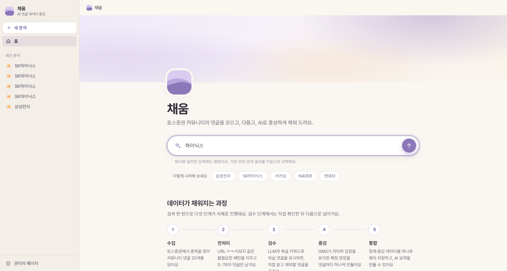
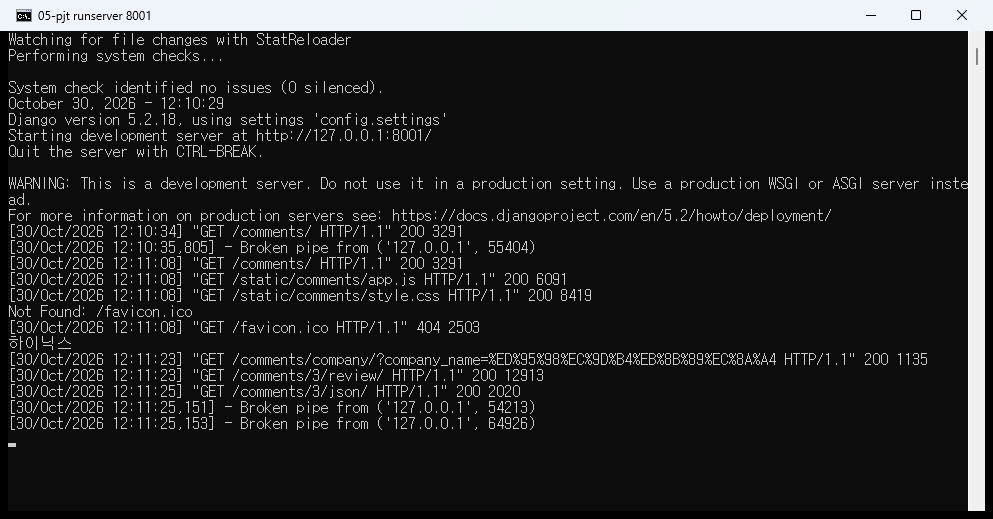
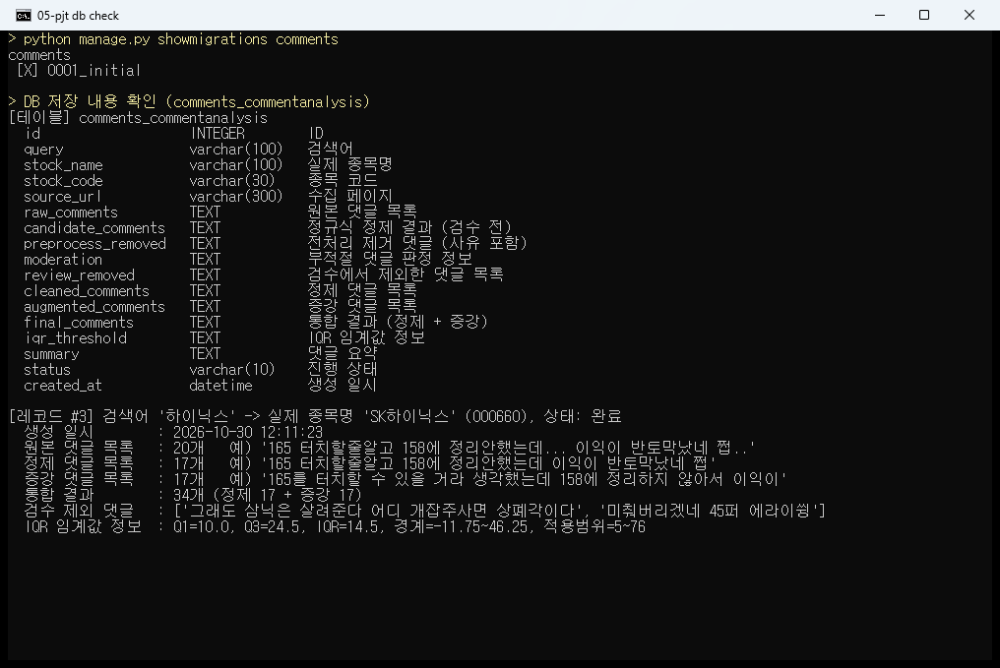
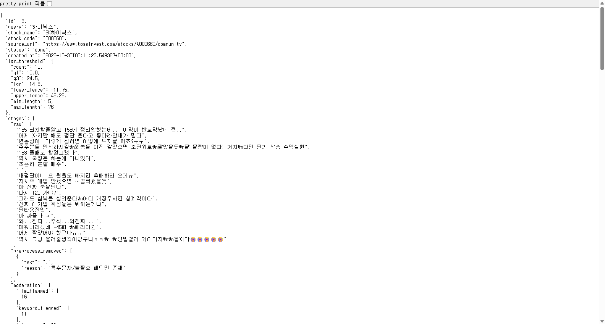
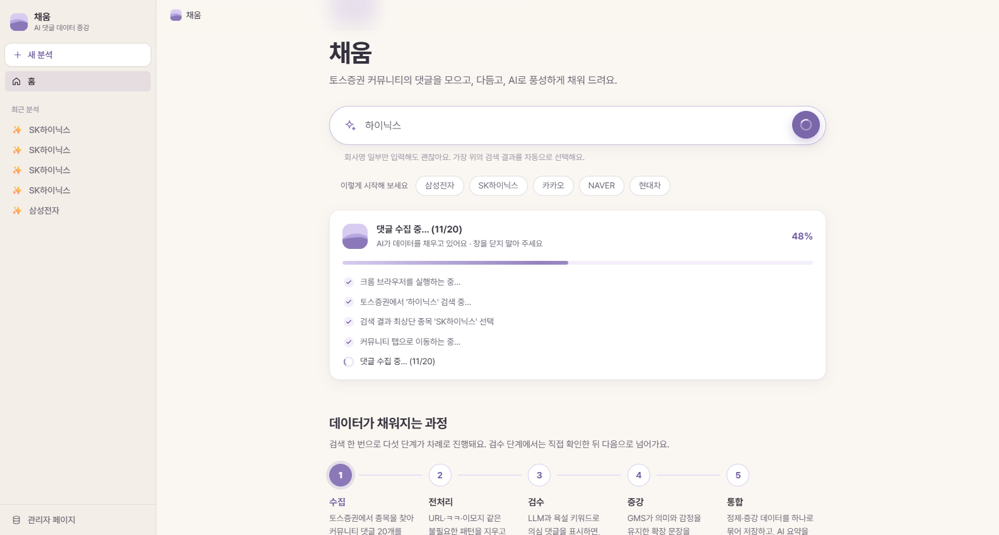
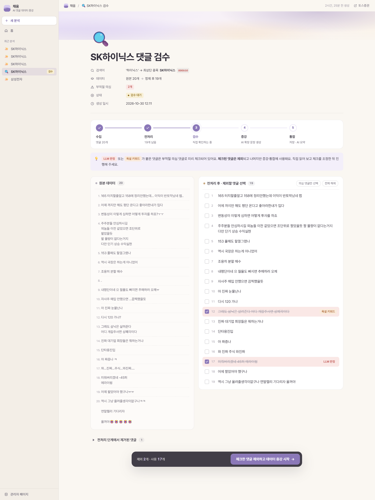
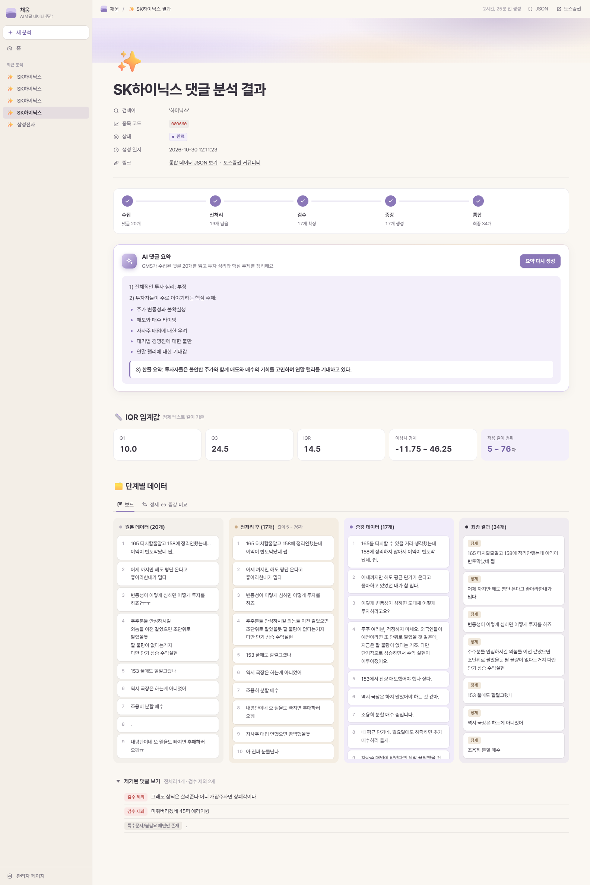
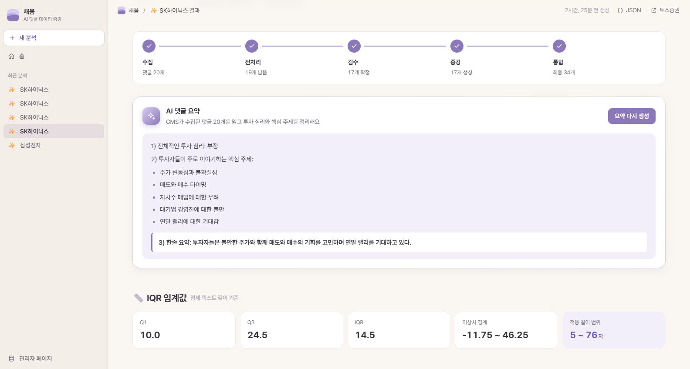
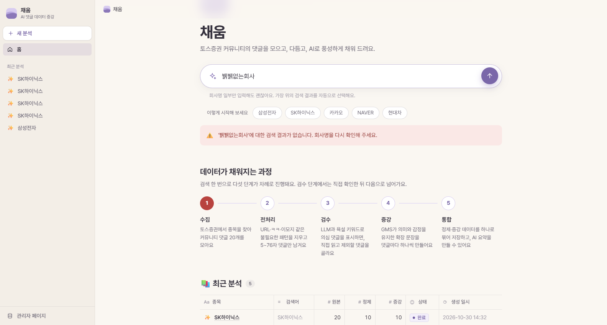
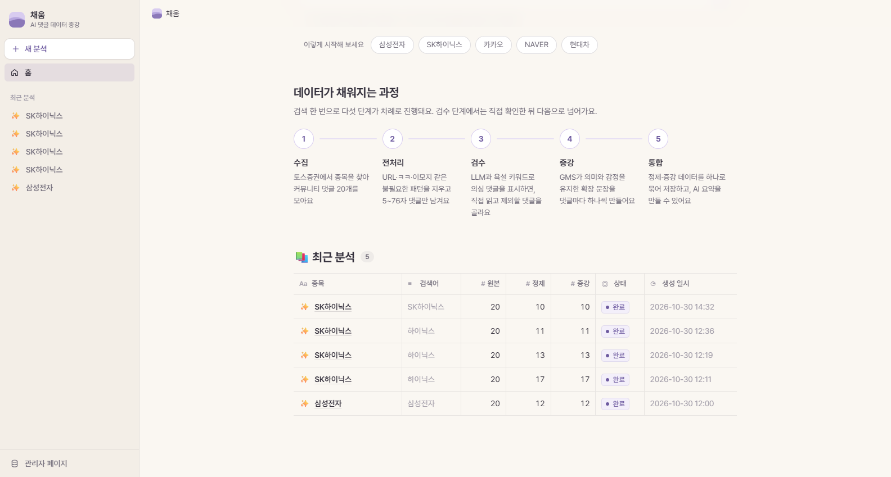

# 채움 : 토스증권 커뮤니티 댓글 크롤링 & 데이터 증강 시스템

Django 웹 애플리케이션에서 사용자가 입력한 회사명으로 **토스증권 커뮤니티 댓글을 Selenium 으로 실시간 수집**하고,
정규표현식 전처리 → 부적절 댓글 검수(LLM + 사용자 직접 확인) → **GMS LLM 기반 데이터 증강** → 통합 저장·출력까지
하나의 파이프라인으로 처리하는 서비스입니다.

```
사용자 입력 ─▶ 크롤링(Selenium) ─▶ 전처리(re) ─▶ 부적절 댓글 검수(GMS + 직접 확인) ─▶ 증강(GMS) ─▶ 통합 저장·출력 (+ 요약)
   F601          F603 · F604          F605              F605                         F606        F602 · F607 · F610
```

---

## 1. 실행 방법

> Python 3.11, Chrome 브라우저가 설치되어 있어야 합니다. (ChromeDriver 는 webdriver-manager 가 자동 설치)

```powershell
# 1) 가상환경 생성 및 활성화 (Windows PowerShell)
python -m venv .venv
.\.venv\Scripts\Activate.ps1

# 2) 패키지 설치
pip install -r requirements.txt

# 3) 환경변수 파일 생성 후 GMS_KEY 입력
Copy-Item .env.example .env

# 4) DB 마이그레이션
python manage.py migrate

# 5) 서버 실행 → http://127.0.0.1:8000/comments/
python manage.py runserver
```

| 환경변수 | 설명 | 기본값 |
| --- | --- | --- |
| `GMS_KEY` | SSAFY GMS API 키 (**필수**) | - |
| `GMS_MODEL` | 사용할 모델명 | `gpt-4o-mini` |
| `GMS_BASE_URL` | GMS OpenAI 호환 엔드포인트 | `https://gms.ssafy.io/gmsapi/api.openai.com/v1` |
| `CRAWLER_HEADLESS` | `False` 면 크롬 창을 띄워 크롤링 과정을 직접 볼 수 있음 | `True` |
| `CRAWLER_COMMENT_LIMIT` | 수집할 댓글 수 | `20` |

테스트 (네트워크 없이 실행 가능, 크롤러·GMS 는 mock 처리)

```powershell
python manage.py test comments
```

---

## 2. 주요 기능

### 기본 기능 (필수)

| 번호 | 기능 | 구현 내용 |
| --- | --- | --- |
| F601 | 회사명 입력 및 검증 | 입력값이 있으면 VS Code 터미널에 회사명을 `print` 하고 수집 시작. 공백/빈 값이면 프론트(JS)에서 아무 동작도 하지 않고, 서버에서도 수집 없이 메인으로 돌려보냄. 회사명 일부만 입력해도 검색 가능 |
| F602 | DB 스키마 구성 | `CommentAnalysis` 모델에 실제종목명, 원본/정제/증강 댓글 목록, IQR 임계값 정보, 생성 일시 등 단계별 결과를 저장하고 마이그레이션 완료 |
| F603 | 회사 검색 및 선택 | 토스증권 우측 상단 검색창 클릭 → 회사명 입력 → 자동 포커싱된 **최상단 종목을 Enter 로 선택** (예: `삼성` → `삼성전자`, `카카` → `카카오`). 크롤링 진행 상황을 **스트리밍**으로 실시간 출력 |
| F604 | 커뮤니티 댓글 수집 | 종목 상세 페이지의 `커뮤니티` 탭으로 이동 후, 스크롤로 게시글을 추가 로딩하며 댓글 **20개** 수집 |
| F605 | 댓글 데이터 정제 | 결측치 제거, URL·`ㅋㅋㅋ`/`ㅠㅠ` 등 자음·모음 패턴·특수문자·이모지 제거, 반복 글자 축약, 공백 정리, **길이 5 이상 ~ 76 이하** 필터링, 중복 제거, **GMS LLM 으로 부적절 댓글 판별** |
| F606 | 텍스트 데이터 증강 | 정제된 댓글마다 의미·감정·핵심 정보를 유지한 확장 문장을 GMS 로 1개씩 생성 |
| F607 | 데이터 통합 관리 | 원본 · 전처리 · 증강 · 최종 결과(정제+증강, 단계 라벨 포함)를 한 화면에 출력하고 DB 에 저장. JSON 으로도 확인 가능 |

### 심화 기능

| 번호 | 기능 | 구현 내용 |
| --- | --- | --- |
| F610 | 댓글 요약 생성 | 결과 화면의 **[댓글 요약 보기] 버튼** 클릭 시 수집된 전체 댓글을 GMS 로 요약 (투자 심리, 핵심 주제, 한줄 요약) 후 DB 에 저장 |
| F611 | 예외 상황 안내 | 검색 결과 없음 / 커뮤니티 댓글 없음 / 전처리 후 남은 댓글 없음 / 크롬 실행 실패 / GMS 오류 등 상황별 안내 메시지 출력 |

### 추가 아이디어

- **부적절 댓글 직접 검수 단계** : LLM 이 판정한 댓글(`LLM 판정`)과 욕설 키워드가 포함된 댓글(`욕설 키워드`)을 빨간색으로 표시하고 미리 체크해 둡니다.
  사용자가 직접 읽어 보고 체크를 조정한 뒤 확정하면, 체크된 댓글만 제외하고 증강을 진행합니다. LLM 이 놓치거나 과하게 판정한 댓글을 사람이 바로잡을 수 있습니다.
- **IQR 임계값 계산** : 정제된 댓글 길이의 Q1, Q3, IQR, 이상치 경계(Q1−1.5·IQR ~ Q3+1.5·IQR)를 계산해 저장하고 결과 화면에 표시합니다. (실제 필터링은 명세의 5~76자 기준 적용)
- **제거 사유 기록** : 전처리에서 제거된 댓글과 사유(결측치, 길이, 중복 등), 검수에서 제외된 댓글을 따로 저장·표시합니다.
- **최근 분석 기록** : 메인 화면에서 지난 분석 결과를 다시 열어볼 수 있습니다. (관리자 페이지 `/admin/` 에서도 조회 가능)

---

## 3. 프로젝트 구조

```
05-pjt/
├── config/                     # Django 프로젝트 설정 (settings, urls)
├── comments/                   # 댓글 수집·가공 앱
│   ├── services/               # 단계별로 분리된 처리 모듈 (독립적으로 재사용 가능)
│   │   ├── crawler.py          #   F603·F604  Selenium 크롤링
│   │   ├── preprocess.py       #   F605       정규식 정제, 길이 필터, IQR, 욕설 키워드
│   │   ├── llm.py              #   F605·F606·F610  GMS API (부적절 판별, 증강, 요약)
│   │   └── integration.py      #   F607       정제 + 증강 데이터 통합
│   ├── models.py               # F602 CommentAnalysis 모델
│   ├── context_processors.py   # 사이드바 최근 분석 목록
│   ├── templatetags/chaeum.py  #  인라인 SVG 아이콘 태그
│   ├── views.py                # 입력 → 처리 → 출력 흐름 제어 (스트리밍 응답 포함)
│   ├── urls.py
│   ├── templates/comments/     # base, index, review(검수), result(결과), _steps(단계 표시)
│   ├── static/comments/        # style.css, app.js
│   ├── migrations/
│   └── tests.py                # 단위 테스트 20개
├── 산출물/                     # 실행 결과 캡처 + 요구사항 점검표
├── .env.example                # 환경변수 예시 (.env 는 업로드 금지)
├── requirements.txt
└── manage.py
```

### URL

| URL | 설명 |
| --- | --- |
| `GET /comments/` | 메인 (회사명 입력, 최근 분석 기록) |
| `GET /comments/company/?company_name=삼성` | 크롤링·전처리 실행, 진행 상황을 NDJSON 으로 스트리밍 |
| `GET, POST /comments/<id>/review/` | 부적절 댓글 검수 → 확정 시 증강·통합 후 저장 |
| `GET /comments/<id>/` | 원본 / 전처리 / 증강 / 최종 결과 통합 출력 |
| `POST /comments/<id>/summary/` | 댓글 요약 생성 (F610) |
| `GET /comments/<id>/json/` | 통합 결과 집합 JSON |

### DB 스키마 (`CommentAnalysis`)

| 필드 | 내용 |
| --- | --- |
| `query` | 사용자가 입력한 검색어 |
| `stock_name` / `stock_code` | **실제 매칭된 종목의 공식 명칭** / 종목 코드 |
| `raw_comments` | **원본 댓글 목록** |
| `candidate_comments` | 정규식 정제 결과 (검수 전) |
| `preprocess_removed` | 전처리에서 제거된 댓글과 사유 |
| `moderation` | LLM 판정 인덱스, 욕설 키워드 인덱스, LLM 오류 메시지 |
| `review_removed` | 검수에서 사용자가 제외한 댓글 |
| `cleaned_comments` | **정제 댓글 목록** (검수 확정 후) |
| `augmented_comments` | **증강 댓글 목록** |
| `final_comments` | 통합 결과 `[{"stage": "cleaned" \| "augmented", "text": ..., "source": i}]` |
| `iqr_threshold` | **IQR 임계값 정보** (Q1, Q3, IQR, 이상치 경계, 적용 길이 범위) |
| `summary` | 댓글 요약 |
| `status` | 진행 상태 (검수 대기 / 완료) |
| `created_at` | **생성 일시** |

---

## 4. 실행 결과

`하이닉스` 를 검색한 결과입니다. (최상단 종목 **SK하이닉스** 자동 선택 → 원본 20개 → 전처리 19개 → 검수 제외 2개 → 정제 17개 → 증강 17개 → 최종 34개)
캡처 원본은 [`산출물/`](산출물) 폴더에 있으며, 요구사항별 점검 결과는 [`산출물/요구사항_점검표.md`](산출물/요구사항_점검표.md) 에 정리했습니다.

### F601 회사명 입력 및 검증

입력창에 회사명 일부(`하이닉스`)를 입력합니다.



입력한 회사명이 VS Code 터미널에 출력됩니다.



### F602 DB 스키마 구성 및 저장

마이그레이션 적용 상태, 테이블 구조, 저장된 레코드(실제 종목명, 원본/정제/증강 목록, IQR 임계값, 생성 일시)를 확인합니다.



DB 에 저장된 통합 결과 집합을 JSON 으로 조회한 화면입니다. (`/comments/3/json/`)



### F603 회사 검색 및 선택 (크롤링 진행 상황 스트리밍)



### F604 · F605 댓글 수집 · 전처리 · 부적절 댓글 검수

원본 20개 수집 → 정규식 전처리 후 19개. `욕설 키워드`(개잡주)와 `LLM 판정`(에라이쓍) 댓글 2개를 확인 후 제외했습니다.



### F606 · F607 데이터 증강 및 통합 결과



### F610 댓글 요약



### F611 예외 상황 안내



### 추가 기능 : 최근 분석 기록



---

## 5. 학습 내용

- **Selenium 동적 크롤링** : 토스증권은 React 기반 SPA 라서 `requests` 만으로는 데이터를 얻을 수 없었고, Selenium 으로 실제 브라우저를 조작해야 했다.
  클래스명(`tw1n-xxxx`)은 배포마다 바뀌는 해시값이라 `data-section-name`, `data-content-value` 같은 **의미 있는 data 속성**으로 요소를 찾는 것이 더 안정적이라는 것을 배웠다.
- **명시적 대기(WebDriverWait)** : `time.sleep` 대신 요소가 나타날 때까지 기다리는 방식을 사용했고, 검색어 입력 중간 결과를 잘못 잡지 않도록 "같은 결과가 두 번 연속 나오면 확정"하는 방식으로 처리했다.
  안내 말풍선이 탭을 가려 `ElementClickInterceptedException` 이 나는 문제는 JavaScript 클릭으로 해결했다.
- **무한 스크롤 수집** : 마지막 게시글로 `scrollIntoView` 하여 추가 로딩을 유도하고, 게시글 id 로 중복을 제거하며 원하는 개수만큼 수집했다.
- **정규표현식 전처리** : 자음·모음 범위(`[ㄱ-ㅎㅏ-ㅣ]`), 한글·영문·숫자 외 문자(`[^0-9a-zA-Z가-힣\s]`), 반복 글자 등 패턴을 단계적으로 적용했다.
  반복 글자 축약 규칙을 숫자에도 적용하면 `1000` 이 `100` 이 되는 문제가 있어, 테스트로 발견하고 문자에만 적용하도록 수정했다.
- **IQR** : 사분위수로 데이터의 분포와 이상치 경계를 계산하는 방법을 익혔다.
- **LLM API 활용** : GMS(OpenAI 호환 API)를 `requests` 로 호출하고, 응답을 JSON 배열로 받도록 프롬프트를 설계했다.
  LLM 응답에 코드 블록이나 설명이 섞여 오는 경우를 대비해 JSON 부분만 추출해 파싱하고, 증강 결과 개수가 어긋나면 하나씩 다시 요청하도록 처리했다.
- **Django 스트리밍 응답** : `StreamingHttpResponse` 와 `fetch` 의 `ReadableStream` 을 이용해 오래 걸리는 크롤링 진행 상황을 실시간으로 화면에 보여주었다.
  크롤링은 별도 스레드에서 실행하고, 진행 메시지는 `queue.Queue` 로 받아 바로 전송했다.
- **관심사 분리** : 크롤링 / 전처리 / LLM / 통합을 `services` 모듈로 분리하여, 뷰는 흐름만 제어하고 각 단계는 독립적으로 테스트·재사용할 수 있게 구성했다.
- **mock 을 활용한 테스트** : 외부 서비스(토스증권, GMS)에 의존하는 부분을 `unittest.mock` 으로 대체하여 네트워크 없이도 전체 흐름을 검증했다.

## 6. 느낀 점

- 실제 서비스 페이지를 크롤링해 보니, 화면에서 보이는 것과 DOM 구조가 다르고 클래스명도 계속 바뀌어서
  "어떤 기준으로 요소를 찾아야 오래 유지되는 코드가 되는가"를 고민하게 되었다.
- LLM 이 부적절 댓글을 판별해 주지만 기준이 애매한 댓글도 많았다. 실제로 같은 SK하이닉스 댓글 목록을 두 번 검사했을 때
  한 번은 `에라이쓍` 같은 돌려 말한 욕설을 놓쳤고, `개잡주` 같은 비속어는 두 번 모두 키워드 감지로만 걸러졌다.
  자동 판정을 그대로 믿기보다 사람이 최종 확인하는 검수 단계를 두는 것이 데이터 품질 측면에서 더 안전하다고 느꼈다.
- 전처리 규칙 하나를 바꿀 때마다 결과 데이터가 크게 달라져서, 테스트 코드를 먼저 만들어 두니 수정이 훨씬 수월했다.
- 크롤링처럼 오래 걸리는 작업은 진행 상황을 보여주는 것만으로도 사용자 경험이 크게 좋아진다는 것을 체감했다.
